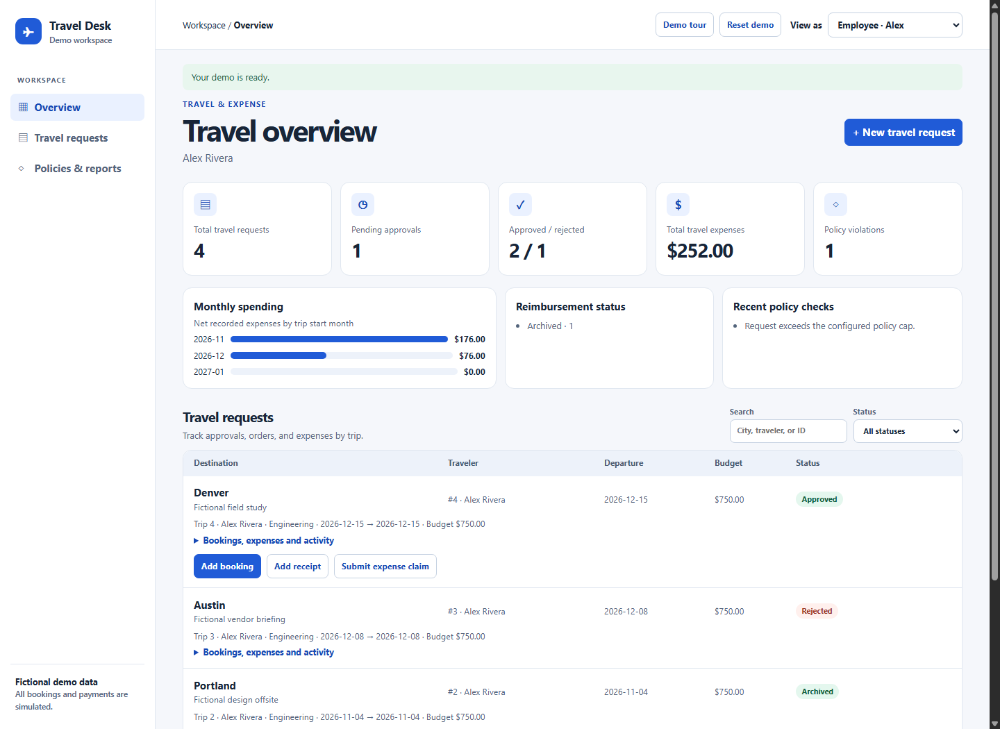

# Travel Desk Public v3

Travel Desk is a portfolio demo for enterprise travel and expense management. Visitors can run a complete fictional trip through request, policy review, approval, simulated booking, expense submission, reconciliation, and settlement.

## Key features

| Demo role | Actions |
| --- | --- |
| Employee | Create or revise requests, check policy, book simulated inventory, enter and verify receipts, submit claims, and delegate receipt and claim work to another fictional employee. |
| Manager | Approve, return, or reject travel requests, review claims, and export summary CSVs. |
| Finance | Record partial or final refunds, import and correct statements, review discrepancies, produce vouchers, record simulated payments, and archive trips. |
| Admin | Publish dated policy versions, configure policy grades as roles, bind employees to grades, and update the workspace display name. |

A visitor can switch roles using **View as**. The server persists the active actor and validates each action against the selected role, trip state, and ownership or delegation. The overview shows database-derived request counts, approval outcomes, blocked policy checks, spending by trip start month, and reimbursement status. **Reset demo** restores the sample workspace.

## Tech stack

- Python standard library for the HTTP and workflow layers
- SQLite for transactions, persistence, and foreign keys
- HTML, CSS, and vanilla JavaScript for the responsive browser client
- Docker Compose and Caddy deployment configuration
- Python `unittest` for automated checks

## System architecture

The browser sends same-origin requests to Python. The session cookie selects one SQLite file, and that database supplies both the active actor and workflow state. Caddy terminates TLS in the deployment configuration. See the [architecture diagram and database design](docs/ARCHITECTURE.md).

## Database design

`trips` is the parent of bookings, receipts, statement lines, and activity events. Policy templates have append-only versions. Employee bindings select a policy grade and its template. Approval copies the matched rules and version metadata to the trip as an immutable snapshot. USD values are stored as integer cents. See the [schema and accounting notes](docs/ARCHITECTURE.md#database-design).

## End-to-end workflow

1. Employee submits a request. The travel start date selects the applicable policy version, and over-cap requests are blocked and recorded.
2. Manager approves, returns, or rejects the request. Approval freezes the policy snapshot.
3. Employee selects a simulated booking, adds a verified receipt, and submits an expense claim.
4. Manager approves the claim and passes it to Finance.
5. Finance compares supplier statement lines against company-paid orders. Amount or reference differences and pending refunds block voucher generation.
6. Finance generates a voucher, records the simulated settlement, and archives the paid trip. The dashboard reflects the recorded amounts and statuses.

## Demo instructions

Open the local app, select **Try Live Demo**, and open **Demo tour** from the top bar. Use the **Seattle** sample for a five-minute walkthrough.

| Time | Role and action |
| --- | --- |
| 0:00 | As Employee, try a new request with a $2,500 budget to see a fictional cap violation. Use the seeded Seattle request for the following steps. |
| 0:45 | Switch to Manager and choose **Approve trip** on Seattle. |
| 1:30 | Switch to Employee · Alex. Add a company Flight for $245, add receipt reference `DEMO-RAIL`, then submit the expense claim. |
| 2:30 | Switch to Manager and approve Seattle's expense claim. |
| 3:00 | Switch to Finance. Open Seattle's details and copy the flight order ID. Import the supplier statement as `ORDER-ID,245.00` with a reason. Reconcile, generate a voucher, then record a successful simulated payment. |
| 4:30 | View the updated overview. For the refund branch, record a $68 final Rail refund on Denver. For policy administration, switch to Admin. |

Austin illustrates a rejected request. Portland illustrates a completed settlement. In Seattle, entering `244.00` in the statement before correcting it to `245.00` illustrates discrepancy handling. **Reset demo** restores all four examples.

## Local setup

Run Python 3.10 or later from the project root.

```sh
python server.py
```

Open <http://127.0.0.1:8000>. The default store is `.demo-data/`. Set `HOST`, `PORT`, or `DEMO_DATA_DIR` in the process environment to override defaults. A direct Python launch reads environment variables from the shell.

## Deployment

**Live Demo URL** · Pending public HTTPS verification.

### Railway

Extract the allowlisted release ZIP and upload that directory with the Railway CLI, or connect a GitHub repository created from the extracted contents. Railway builds the existing Dockerfile remotely. The app has no external database or runtime dependencies.

| Service setting | Value |
| --- | --- |
| Region and replica count | One region, one replica |
| Volume | Attach at `/data` before deploying |
| `RAILWAY_RUN_UID` | `0`, required for Railway's root-owned volume with this Dockerfile |
| `DEMO_MAX_SESSIONS` | `100` for the free-tier disk |
| `DEMO_TTL_HOURS` | `24` |
| Port | Platform-provided `PORT`, read by Python |
| Startup health | `/healthz`, configured in `railway.toml` |

The start command requires a writable mounted volume and configures secure cookies. After deploying, generate a Railway public domain. Check HTTPS from an external browser and run the five-minute walkthrough before adding the link above. Restart the single instance and confirm that a non-expired session still has its edited records. Anonymous visitors need no Railway or GitHub account. Capacity and availability depend on the Railway plan and credits. See [Railway pricing](https://docs.railway.com/pricing/plans) and [volume permissions](https://docs.railway.com/volumes).

### Docker Compose

The Compose stack is designed for one Docker host with a persistent volume and a public DNS hostname. Caddy exposes ports 80 and 443. SQLite stays on the host's named volume, and the Python service uses secure session cookies.

1. Point a public DNS hostname at the host and allow inbound TCP ports 80 and 443.
2. Copy `.env.example` to `.env` and set `DEMO_DOMAIN` to the hostname.
3. From the source directory run the following, replacing the sample hostname with your domain.

```sh
docker compose config --quiet
docker compose up -d --build
docker compose ps
curl --fail --show-error https://demo.example.com/healthz
curl --fail --show-error https://demo.example.com/
```

Open the HTTPS URL from a separate network. Start the demo, reload to check cookie persistence, compare two private browser sessions, and test role switching and reset. Preserve the named `demo_data` volume across upgrades and keep one application replica. Sessions expire after 24 hours of inactivity by default. `DEMO_TTL_HOURS` and `DEMO_MAX_SESSIONS` are configurable. Expired files are removed on incoming API activity.

## Testing

```sh
python -B -m unittest discover -s tests -v
node --check public/app.js
python -B scripts/package_public.py
```

The original suite covers migration, workflow transitions, booking and refund behavior, reconciliation, policy snapshots, CSV access, and package exclusions. HTTP integration tests cover server-side role checks, stale forms, session isolation and reset, expiration, policy violation audits, and end-to-end settlement. Node.js is used only for the optional JavaScript syntax check. The ZIP exporter checks its source allowlist, CRCs, and extraction.

## Screenshots

The screenshots below show the app running against its fictional SQLite seed.



- [Demo welcome](docs/screenshots/welcome.png)
- [Employee overview](docs/screenshots/overview.png)
- [Manager approval](docs/screenshots/manager-approval.png)
- [Finance reconciliation](docs/screenshots/finance-reconciliation.png)
- [Admin policies](docs/screenshots/admin-policies.png)
- [Mobile overview](docs/screenshots/mobile-overview.png)

## Security & data disclaimer

This is a fictional portfolio sandbox. Names, scenarios, city groups, policy grades, hotel-night rules, and spending limits were created for demonstration. The underlying corporate source material was unavailable for verification. Enter fictional information only. The app uses local simulated inventory, receipt verification, vouchers, refunds, and settlement, with no external bookings or payments.

Public role switching represents demo personas. Session access uses a random HTTP-only cookie, same-origin writes with a custom header, and one isolated database per visitor. Requests and storage are bounded. Retain the TLS proxy and secure cookies in public hosting. The public source archive excludes runtime databases, environment secrets, previous archives, and historical source-review notes.

## Résumé bullets

- Built an enterprise travel and expense SaaS demo covering policy checks, approval, simulated booking, claims, refunds, and line-item reconciliation with Python, SQLite, and vanilla JavaScript.
- Implemented role-checked workflows, isolated visitor sessions, and effective-dated policy versions with immutable approval snapshots.
- Added database-backed analytics, automated workflow and session tests, and a Docker Compose deployment configuration with a persistent SQLite volume and HTTPS proxy.
