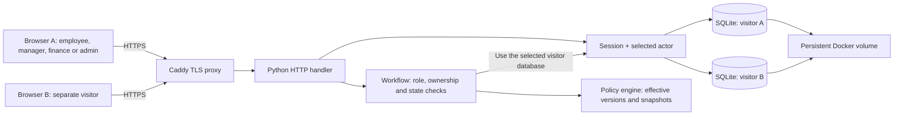
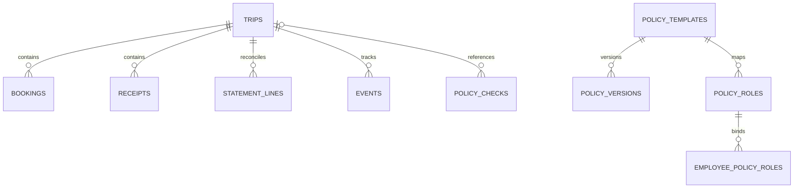
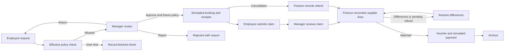

# Travel Desk architecture

## System diagram

Local development uses the same Python routes over loopback HTTP. The static HTML, CSS, and JavaScript are served from an explicit route list. One process serializes session operations, including reset and expiry, while SQLite commits workflow changes and audit events together.

On Render Free, Render provides the TLS proxy and the app stores SQLite files under `/tmp/travel-desk`. Startup atomically initializes a fictional template if absent. Session creation and reset copy that template under the process lock and give each copy a fresh revision. A missing cookie-backed workspace is restored on the workspace read using a new cookie. An obsolete mutation is refused, so it cannot apply to seeded records after recovery. Render may discard all temporary files on sleep, restart or deployment.

## Database design

| Data | Details |
| --- | --- |
| Trips and child records | Orders, receipts, provider statement lines and activity use trip IDs. USD amounts are integer cents. |
| Policy configuration | Templates, versions and employee grade bindings are stored independently of the application's demo access roles. Trips retain JSON policy snapshots after approval. |
| Policy checks | Blocked attempts record the actor, reason, action, and a trip ID when applicable. Retried checks can share a request ID. |
| Authorizations and activity | Delegation expires and applies only to receipt and claim submission. Configuration actions are audited. Successful workflow requests can be retried with the same ID without duplicating the action. |
| Demo session | A persistent row stores the selected actor, workspace display name and revision. Reset atomically replaces this visitor's database with a seeded copy while issuing a new revision. |
| Settlement | Company-paid order amounts plus fees minus received refunds are reconciled against individual supplier lines. Receipts and personal bookings contribute to the employee amount. |

Monthly spending groups the net provider and employee amounts by trip start month. Pending counts include pending trip approval, manager claim approval, and finance review. Reimbursement statuses count trips that have a claim submission event. A violation is an attempt blocked by a policy limit or a policy-controlled booking option.

## Workflow

## Policy matching

The employee's grade binding selects a template. The most recent effective start date wins, and the last publication breaks same-date ties. End dates are inclusive. An expired winning version leaves a configuration gap. Approval saves a full rule and version snapshot. Later bookings and amendments use the snapshot.

The fictional city group overrides the default hotel cap. Administrators can publish a per-booking hotel cap or a per-night cap. For the optional nightly demo rule, nights are the difference between the trip start and end dates, with a minimum of one. Seed templates use per-booking limits. Transport category amounts, cabin and seat restrictions, and payment modes are versioned. Local legacy migrations preserve existing records and amount-only snapshots.

## HTTP surface

| Route | Purpose |
| --- | --- |
| `GET /healthz` | Process health check |
| `POST /api/session` | Start or resume a fictional visitor workspace |
| `POST /api/role` | Change persona in the current workspace |
| `POST /api/reset` | Restore fictional scenario data and switch to Employee |
| `GET /api/trips` | Load role-scoped workspace data and analytics |
| `POST /api/trips` | Run a role- and state-checked workflow operation |
| `GET /api/report.csv` | Finance ledger |
| `GET /api/summary.csv` | Manager and Finance summary |

The server validates the demo session cookie and selected persona, requires an application header for writes, and rejects mutations from forms opened before a reset or a role change. Each workspace has a storage limit. Idle expiry and the total session cap bound retained files. The deployment uses a single application process on one host.
